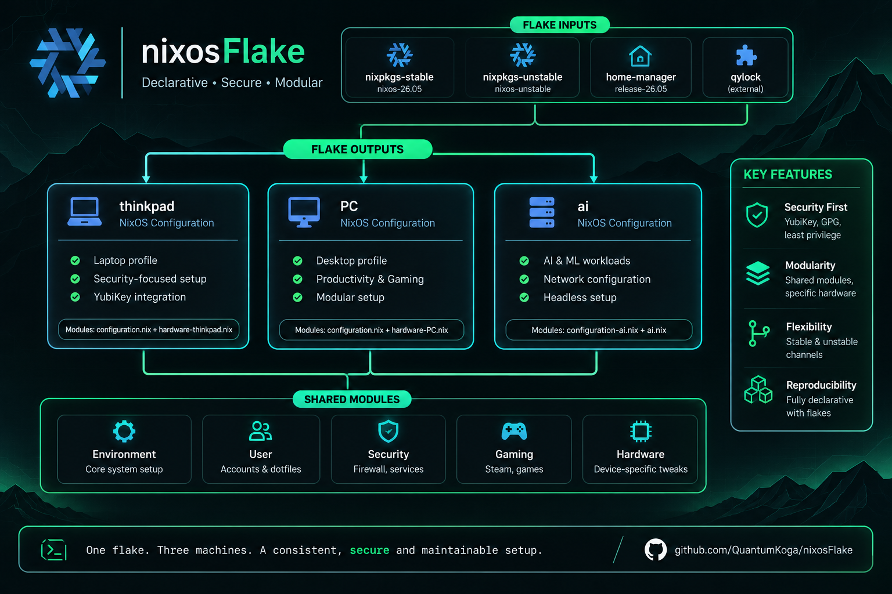

# NixOS Flake

My personal NixOS configuration, built around Nix Flakes and Home Manager.

This repository contains a modular, multi-machine NixOS setup designed to keep system configuration, user settings, security, gaming and desktop environment components separated and reusable.

The flake currently supports three different machine profiles, sharing common modules wherever possible.

## Machine Profiles

Each machine has its own hardware configuration and system profile.

| Profile | Description |
|---|---|
| `thinkpad` | Laptop configuration, including Intel hardware and laptop-specific settings |
| `PC` | Desktop PC configuration, including AMD hardware, dedicated storage mounts and gaming support |
| `ai` | Dedicated AI server configuration with separate hardware and networking settings |

All profiles target `x86_64-linux`.

## Configuration Structure

The configuration is split into independent modules to make it easier to maintain, extend and reuse across machines.


### System Modules

- **Environment (`environment.nix`)** – Desktop environment and system-wide graphical configuration. Includes Hyprland, SDDM, Qt, themes, fonts, Quickshell dependencies and desktop utilities.
- **User (`user-quantum.nix`)** – User account, installed applications, shell configuration, SSH, Git and Home Manager settings.
- **Security (`security.nix`)** – GPG, YubiKey tooling, smart-card support and authentication-related configuration.
- **Gaming (`gaming.nix`)** – Steam, Proton-GE and graphics support. Currently a work in progress.
- **Hardware (`hardware-*.nix`)** – Machine-specific hardware configuration, boot settings, filesystems, CPU and graphics support.

The AI server uses a separate system configuration, allowing it to share selected modules without inheriting the desktop-oriented setup.

### Security & YubiKey

Security configuration is maintained separately from the rest of the system.

Current integrations include:
- GPG agent with SSH support.
- YubiKey management and personalization tools.
- PC/SC smart-card daemon.
- GPG-based Git commit signing.
- YubiKey-backed GPG key integration through Home Manager.
- U2F configuration groundwork.

### User Environment

Home Manager is used to manage user-level configuration.

The current setup includes:
- Zsh with autosuggestions and syntax highlighting.
- Starship prompt.
- Git with automatic GPG commit signing.
- SSH client configuration.
- FZF integration.
- User applications and desktop utilities.

## Package Sources

The flake uses two Nixpkgs channels:

- **Stable:** `nixos-26.05` – Main system package source.
- **Unstable:** `nixos-unstable` – Selected newer packages and applications.

Home Manager follows the stable Nixpkgs input.

This allows newer software to be used without moving the entire system to the unstable channel.

## Requirements

- NixOS
- Nix with Flakes enabled
- Git
- Sufficient privileges to rebuild the system

## Installation

Clone the repository:

```bash
git clone git@github.com:QuantumKoga/nixosFlake.git ~/Documents/nixosFlake
cd ~/Documents/nixosFlake
```

Choose the appropriate profile for your machine.

### Apply a configuration

**ThinkPad:**

```bash
sudo nixos-rebuild switch --flake ~/Documents/nixosFlake#thinkpad
```

**Desktop PC:**

```bash
sudo nixos-rebuild switch --flake ~/Documents/nixosFlake#PC
```

**AI Server:**

```bash
sudo nixos-rebuild switch --flake ~/Documents/nixosFlake#ai
```

The configuration names are case-sensitive.

## Updating

### 1. Update flake inputs

Navigate to the repository:

```bash
cd ~/Documents/nixosFlake
```

Update all flake inputs:

```bash
nix flake update
```

This updates the pinned versions of Nixpkgs, Home Manager and other flake dependencies recorded in `flake.lock`.

### 2. Apply the system configuration

Rebuild your system using the appropriate machine profile:

```bash
sudo nixos-rebuild switch --flake ~/Documents/nixosFlake#thinkpad
```

Replace `thinkpad` with `PC` or `ai` depending on the machine.

### 3. Update NixOS channels

To change the NixOS release channel, edit:

- `flake.nix` – Update the Nixpkgs and Home Manager inputs.
- `nixos/user-quantum.nix` – Update the Home Manager `home.stateVersion` only when intentionally migrating the Home Manager state version.

**Note:** Changing the NixOS release channel does not mean you should automatically change `system.stateVersion` or `home.stateVersion`. These values represent the original state compatibility versions and should generally remain unchanged after installation.

## Maintenance

Useful commands:

```bash
# Check flake configuration
nix flake check

# Show flake outputs
nix flake show

# Update dependencies
nix flake update

# Build without activating
sudo nixos-rebuild build --flake ~/Documents/nixosFlake#thinkpad

# Apply configuration
sudo nixos-rebuild switch --flake ~/Documents/nixosFlake#thinkpad

# List system generations
sudo nix-env --list-generations --profile /nix/var/nix/profiles/system
```

## Project Status

This is my personal, actively evolving NixOS configuration.

Some parts, particularly gaming-related configuration, are still under development. Configurations may change as the setup evolves and new hardware or software requirements are introduced.

Feel free to explore, adapt or use parts of the configuration for your own setup.
